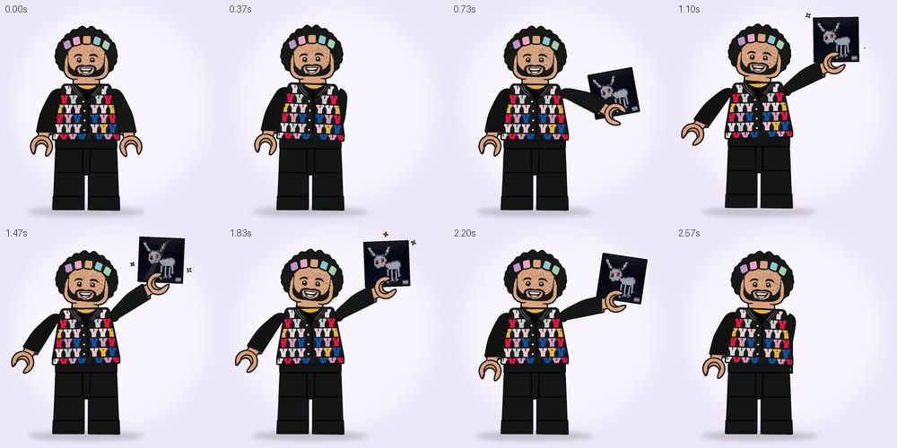

# LEGO COVERS · персонажи показывают обложку · 1000×1000 · 3 с, луп

Те же векторные LEGO-персонажи с ровной обводкой, что и в `lego_squad` / `lego_scenes`, только теперь каждый достаёт обложку и показывает её в камеру. Композиция 1000×1000, 30 fps, 3 секунды, луп без шва.

| Композиция | Что происходит | Превью |
|---|---|---|
| `LEGO_SMILE_VARSITY_COVER` | Заводит руку за спину, достаёт оттуда обложку и поднимает её одной рукой сбоку, на уровне головы. Второй рукой делает «та-да», подпрыгивает, улыбается. По обложке пробегает блик, вокруг вспыхивают звёздочки, затем он прячет обложку обратно за спину. Наряд всё время виден | [mp4](preview/smile_varsity_cover.mp4) · [раскадровка](preview/smile_varsity_cover_storyboard.jpg) |



## Как собрать в After Effects

1. Нужен After Effects 2020 или новее.
2. Рядом со скриптом должны лежать папки `scenes/` (данные сцены) и `assets/` (обложка `cover_for_all_the_dogs.png`).
3. `File → Scripts → Run Script File…` → `build_lego_covers.jsx`. В проекте появится папка `LEGO_COVERS` с композицией и картинкой обложки.

## Слои

- Персонаж: `LEGS` → `TORSO` → `HEAD` / `ARM_L` → `HAND_L` / `ARM_R` → `HAND_R`. Правая рука лежит под туловищем и ногами, поэтому может уйти за спину. Пока кисть за спиной, вместо `HAND_R` видна её копия `HAND_R_BACK`, которая лежит под телом. Копии меняются hold-ключами Opacity в момент, когда кисть сбоку от тела и ни на что не заходит, поэтому подмена незаметна.
- `COVER` — картинка обложки (футаж), ребёнок `HAND_R`. Кисть держит её за середину нижнего края. Rotation посчитан покадрово, чтобы обложка стояла ровно (с лёгким покачиванием). Пока обложка за спиной, она скрыта hold-ключами Opacity: появляется и исчезает, когда полностью закрыта телом.
- `COVER_FRAME` — тонкая обводка вокруг обложки в стиле персонажа. `COVER_GLARE` — блик, бегущий по обложке. `SPARK_*` — звёздочки.
- Чтобы поставить другую обложку, замените файл в `assets/` на квадратный PNG с тем же именем, или впишите другое имя в `COVER` в `tools/covers.py` и пересоберите сцену.

## Инструменты

```bash
python3 tools/covers.py                                            # сцены -> scenes/*.jsxinc и build_lego_covers.jsx
python3 ../lego_scenes/tools/render.py all --root .                # превью mp4 + раскадровки -> preview/
npm i acorn && node ../nike_loop/tools/ae_mock_check.js build_lego_covers.jsx
```

Сцены описаны на том же наборе, что и `lego_scenes` (`scenekit.py`, `scenes.py`). Скрипт для AE и превью читают одни и те же данные, поэтому превью совпадает с композицией.

> Скрипт проверен на имитации API After Effects (1 композиция, 19 слоёв, ошибок нет): настоящего AE в среде сборки нет. Если при запуске что-то пойдёт не так, текст ошибки будет в итоговом окне.
